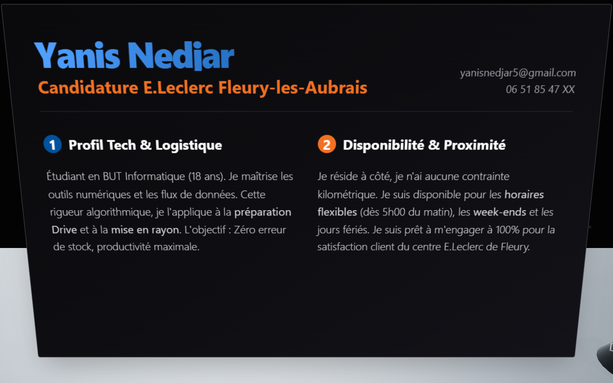

# Portfolio 3D Interactif (Three.js & React)

<p align="center">
  <a href="https://react.dev"></a>
  <a href="https://threejs.org"></a>
  <a href="https://docs.pmnd.rs/react-three-fiber"></a>
  <a href="https://tailwindcss.com"></a>
  <a href="https://www.framer.com/motion"></a>
  <a href="https://nedjaryanis.github.io/cv-leclerc/"></a>
</p>

<div align="center">
  <a href="https://nedjaryanis.github.io/cv-leclerc/">
    
  </a>
</div>

<br/>

Expérience web immersive en 3D développée avec **React 19**, **Three.js** et **React Three Fiber (R3F)**. L'application propose une présentation visuelle moderne avec une caméra dynamique plongeante, un environnement volumétrique avec effets de particules (`Sparkles`), des ombres de contact réalistes et des animations fluides orchestrées par **Framer Motion**.

---

## Démo en Ligne

L'application est déployée sur GitHub Pages :  
**[https://nedjaryanis.github.io/cv-leclerc/](https://nedjaryanis.github.io/cv-leclerc/)**

---

## Caractéristiques Techniques

- **Scène 3D Interactive & Caméra Volumétrique** :
  - Intégration de modèles 3D avec ombrages réalistes (`ContactShadows`).
  - Effets visuels atmosphériques (`Float`, `Sparkles`).
  - Caméra perspective dynamique avec profondeur de champ et réactivité aux mouvements de souris.
- **Architecture de Composants Réactive** :
  - Développé sous la dernière version de **React 19** avec **Vite** comme bundler rapide.
  - Séparation modulaire des couches visuelles 3D (`@react-three/fiber`, `@react-three/drei`) et de la surcouche UI DOM.
- **Design & Animations** :
  - Interface stylisée avec **Tailwind CSS 4** pour une intégration responsive et moderne.
  - Transitions fluides, animations de texte et reveals propulsés par **Framer Motion**.

---

## Structure du Projet

```text
cv-leclerc/
├── public/              # Modèles 3D (GLTF/GLB), textures et assets statiques
├── src/
│   ├── components/      # Composants 3D (Canvas, Scene, Models, Controls)
│   ├── sections/        # Sections DOM interactives superposées
│   ├── styles/          # Configuration Tailwind CSS
│   ├── App.jsx          # Assemblage de la scène et orchestration des états
│   └── main.jsx         # Point d'entrée de l'application
├── package.json         # Dépendances (React 19, Three, R3F, Framer Motion)
└── vite.config.js       # Configuration du bundler Vite
```

---

## Installation & Lancement en Local

```bash
# Cloner le dépôt
git clone https://github.com/NedjarYanis/cv-leclerc.git
cd cv-leclerc

# Installer les dépendances
npm install

# Lancer le serveur de développement local
npm run dev

# Compiler pour la production
npm run build
```

---

## Auteur

Conçu et développé par **[Yanis Nedjar](https://github.com/NedjarYanis)** — Étudiant en BUT Informatique à l'IUT d'Orléans.
